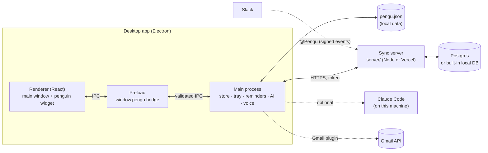

# Pengu 🐧

Open-source desktop app (Windows, macOS, Linux) for discussions, tickets, notes and roadmaps, with a little penguin on your desktop that
shows your meets and tickets and pings you with system notifications. Works fully offline; add the sync server to share with a team.

**Features:** Jira-style window · desktop penguin (`Alt+Shift+P`) · `[[links]]` and `#tags` with backlinks · hand-drawn mind map
(exports to Excalidraw) · live co-editing of documents · optional AI assistant via your local Claude Code · on-device voice (Whisper) ·
**plugins**: tag `@Pengu` in Slack to create tickets, turn labelled Gmail emails into tickets ([`docs/plugins.md`](docs/plugins.md)).

## Architecture



The main process owns all data; windows only render it and ask for changes through the preload bridge. The sync server is optional:
it holds users and roles and merges changes (last write wins; documents merge live with Yjs). Details: [`server/README.md`](server/README.md).

## Setup

Needs **Node 22+**.

```bash
git clone <this repo> pengu && cd pengu
npm run setup     # installs everything, sets up the database, creates the first admin
npm run serve     # terminal 1: sync server on http://localhost:8787 (optional)
npm run dev       # terminal 2: the desktop app
```

In the app: **Settings → Team sync** → `http://localhost:8787`, your username and password.

Manage people (roles: `admin`, `member`, `viewer`):

```bash
npm run pengu -- user add ben --name "Ben" --role member
npm run pengu -- user list
npm run pengu -- doctor          # checks Node, .env and the database
```

Build installers on each OS: `npm run dist:win` · `npm run dist:mac` · `npm run dist:linux` (output in `dist/`).

Using an AI coding assistant? Point it at [`AI_SETUP.md`](AI_SETUP.md).

## Project layout

```
src/main/       Electron main process (store, tray, reminders, AI, voice, sync, plugins/)
src/preload/    the only bridge between pages and main
src/renderer/   React UI (main window + penguin widget)
src/shared/     types and logic used by every layer
server/         sync API, admin CLI (cli/pengu.ts), Prisma schema, plugins/ (Slack)
docs/plugins.md setting up and writing plugins
```

## Contributing

See [`CONTRIBUTING.md`](CONTRIBUTING.md). Security issues: please report privately (GitHub → Security → *Report a vulnerability*),
not in a public issue.

## License

MIT, see [`LICENSE`](LICENSE). Created by [Yash Yadav](https://x.com/yashastro23), the base code owner; keep the copyright notice and
author credit in copies and forks.
